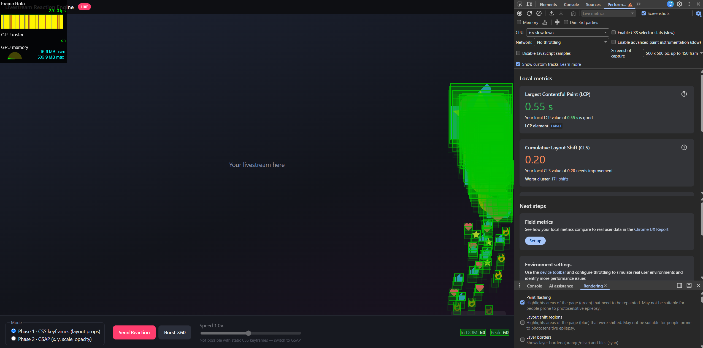
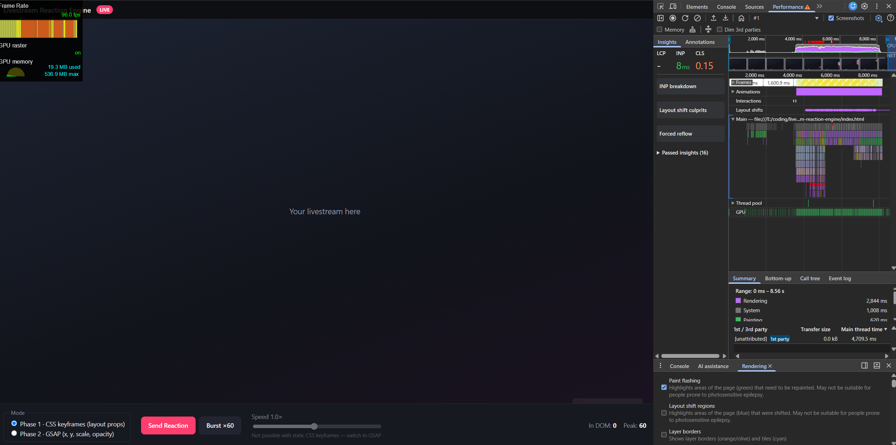
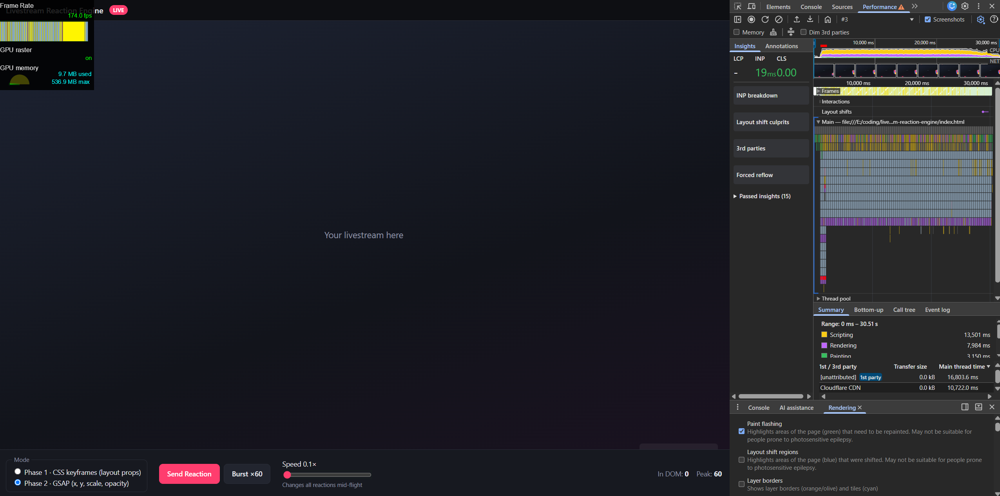
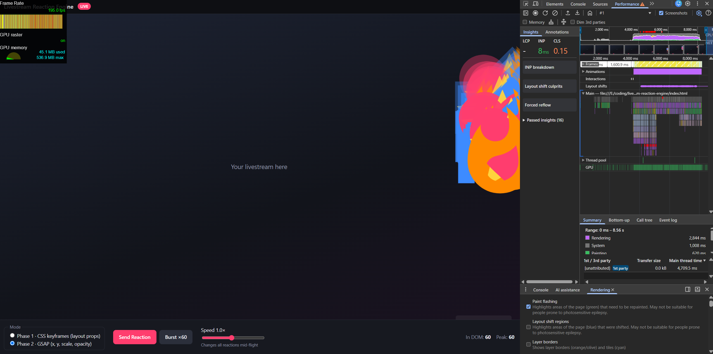

# Livestream Reaction Engine — Submission

## 1. Setup & Running Instructions

No build step or installs needed. Plain HTML, CSS and JavaScript. GSAP is loaded from the cdnjs CDN, so an internet connection is needed for Phase 2.

**Option A — VS Code Live Server:** open the project folder in VS Code, right-click `index.html` → **Open with Live Server**.

**Option B — Python server:**

```bash
python -m http.server 5173
```

Then open <http://localhost:5173> in Google Chrome.

- `http://localhost:5173/?mode=css` → opens directly in Phase 1
- `http://localhost:5173/?mode=gsap` → opens directly in Phase 2

### Controls

| Control | What it does |
|---|---|
| **Mode** | Switch between Phase 1 (CSS keyframes) and Phase 2 (GSAP) |
| **Send Reaction** | Spawns one random reaction (heart, like, fire, star). Press/hold **R** to spam |
| **Burst ×60** | Spawns 60 reactions in under a second — the repeatable 50+ load used for profiling |
| **Speed slider** | 0.1× – 2.0× playback speed of all reactions currently in flight (Phase 2 only) |
| **In DOM / Peak** | Live count of reaction elements on the page. Returning to **0** proves every element was removed |

### Project structure

```
index.html          page, control bar, inline SVG icons
css/styles.css      layout, Phase 1 @keyframes, Phase 2 base styles
js/shared.js        element creation, spawn position, DOM counter
js/phase1-css.js    Phase 1: create element, set CSS variables, remove on animationend
js/phase2-gsap.js   Phase 2: one GSAP timeline per reaction, timeScale control
js/main.js          connects the buttons, slider and mode switch
screenshots/        DevTools evidence
```

### Profiling setup used

- Google Chrome DevTools
- Rendering tab: **Paint flashing** ✔, **Frame Rendering Stats** ✔
- Performance tab: **CPU 6x slowdown**
- Load: **Burst ×60** (60 concurrent reactions) in both phases
- Note: my monitor refreshes above 60 Hz, so frame rates above 60 FPS are possible. The important result is the comparison between the two phases under identical conditions, not the absolute number.

---

## 2. Phase 1: CSS Keyframes Analysis

Each reaction is a `<div>` with the `.reaction--p1` class, which runs four `@keyframes` animations at the same time:

| Effect | Property animated | Work the browser repeats every frame |
|---|---|---|
| Rise | `bottom` | Style → **Layout** → **Paint** → Composite |
| Sway | `margin-left` | Style → **Layout** → **Paint** → Composite |
| Grow | `width` / `height` | Style → **Layout** → **Paint** → Composite |
| Fade | `opacity` | Composite |

The element removes itself in an `animationend` listener when the `p1-rise` animation finishes.

**Paint Flashing Screenshot:**



**Performance Profile Screenshot:**



**Observations:**

* **What regions of the screen flashed green during high-concurrency spawning, and why?**

  The whole column above the spawn area flashed green continuously while the reactions were flying. Every single reaction was repainted on every frame. This happens because `bottom`, `margin-left`, `width` and `height` are layout (geometry) properties: changing them changes the element's size or position, so the browser must recalculate layout and then repaint the pixels at both the old and the new position each frame. With 60 reactions in flight, that is 60 elements being re-laid-out and repainted on every single frame.

* **What did the main thread activity (Layout, Recalculate Style, Paint) look like in the flame chart?**

  The Main track was full of repeating **Recalculate Style → Layout → Paint** blocks in every frame. Because `bottom`, `margin-left`, `width` and `height` change each element's geometry, the browser had to recalculate layout and repaint all 60 reactions on every frame. With 6x CPU throttling, the frame rate dropped to about **96 FPS** during the burst, and frames were noticeably less consistent than in Phase 2.

---

## 3. Phase 2: GSAP & Composited Rendering Analysis

Each reaction gets its own `gsap.timeline()` that animates only compositor-friendly properties:

| Effect | Property animated |
|---|---|
| Rise | `y` (transform) |
| Sway | `x` (transform, yoyo back and forth) |
| Grow | `scale` 0.5 → 1 (transform) |
| Fade | `opacity` |

Every active timeline is stored in a `Set`. The speed slider calls `timeScale()` on each one, so reactions already mid-flight change speed instantly, and new reactions start at the current speed. On `onComplete`, the timeline is killed, the element is removed from the DOM, and it is deleted from the `Set`.

**Resolution independence:** the icons are inline SVG (vector), and each element is laid out at its **largest** size (56px) and only ever scaled **down** (`scale` ≤ 1). The GPU rasterises the layer once at full size and only shrinks it, never stretching a small bitmap, so the icons stay sharp at every point in the animation.

**Performance Profile Screenshot:**



**Paint Flashing Screenshot (for comparison):**



**Observations:**

* **How did the flame chart and frame rate change compared to Phase 1?**

  Under the same 6x CPU throttle and the same 60-reaction burst, the frame rate rose from about **96 FPS (Phase 1)** to about **174 FPS (Phase 2)**, roughly **80% higher**. In the flame chart, the Layout and Paint blocks almost disappeared from the Main track. What remained was mostly small **Scripting** blocks (GSAP's `requestAnimationFrame` tick updating `transform` and `opacity`) plus a short Recalculate Style. Dragging the speed slider down to 0.1× mid-flight was instant and stayed smooth, because changing `timeScale` only changes a number; it does not trigger any layout work.

  | Phase | Animated properties | FPS (6x throttle, 60 reactions) |
  |---|---|---|
  | Phase 1 — CSS keyframes | `bottom`, `margin-left`, `width`, `height`, `opacity` | ~96 |
  | Phase 2 — GSAP | `x`, `y`, `scale`, `opacity` | ~174 |

* **What happened to the green paint invalidation areas once animations moved to composited transforms (`x`, `y`)?**

  The green flashing almost completely disappeared. Each reaction flashed once at most when it first appeared (its layer being painted for the first time), and then never again while it moved, grew and faded. This is because `transform` and `opacity` don't change layout; the GPU compositor just moves, scales and fades the already-painted layer, so no repaint is needed.

**Note:** GSAP still runs on the main thread (it writes `style.transform` every frame from `requestAnimationFrame`), so it is not completely free. If the main thread were blocked by other heavy JavaScript, the animation could still stutter. A pure CSS `transform` animation can run entirely on the compositor thread. GSAP's advantage here is that (a) it only touches compositor-friendly properties, so there is no layout or paint, and (b) it gives full runtime control over every animation.

---

## 4. Architectural Reflection

* **Runtime Control & Developer Experience:**

  With static CSS `@keyframes`, the animation is fixed when it starts. Changing speed mid-flight would mean changing `animation-duration`, which makes elements jump because their progress gets recalculated against the new duration. Working around this needs hacks like negative `animation-delay`, `animation-play-state`, or switching to the Web Animations API. Randomising paths is also limited to values passed in as CSS variables at spawn time; an element already flying can't easily be re-routed. That's why the speed slider is disabled in Phase 1 of this project.

  A GSAP timeline is a live JavaScript object. Methods like `timeScale()`, `pause()`, `reverse()`, `seek()` and `progress()` all work mid-flight, each reaction can be given its own random values in normal JavaScript, and callbacks like `onComplete` make cleanup explicit and reliable. The trade-off is an extra library dependency and some JavaScript running on the main thread every frame.

* **Pipeline Considerations:**

  If reactions need to be tinted, re-themed or altered at runtime based on user preferences, programmatic vector assets (SVG + CSS) are the better choice over pre-rendered raster image sequences:

  - **Tinting & theming:** the SVG icons use `fill: currentColor`, so re-colouring is a single CSS variable change (e.g. `--c-heart`). With raster sequences, every colour or theme needs a whole new set of exported frames.
  - **File size & memory:** one small SVG path vs. dozens of PNG frames per reaction, per colour, per screen density (1×, 2×, 3×). Every decoded bitmap frame also uses GPU memory (width × height × 4 bytes).
  - **Resolution independence:** vectors stay sharp on any screen and at any scale; raster frames blur when scaled up and waste memory when scaled down.
  - **Flexibility:** motion is generated in code, so paths, speed and timing can be randomised or personalised per user without creating new assets.
  - **Costs to watch:** the browser still has to rasterise vectors, and complex SVGs (many paths, filters, blur) are expensive to repaint. The best approach is to keep the SVG simple, let the browser paint it once, and then animate it only with `transform` and `opacity`, never by changing the vector itself every frame. Raster sequences can still make sense for very detailed, hand-designed effects (e.g. an illustrated explosion) that never need to change.

---

## 5. Submission Checklist

- [x] Both Phase 1 and Phase 2 implementations are functional and easily testable.
- [x] DevTools screenshots for both phases are included in the `screenshots/` folder.
- [x] All floating elements are cleanly unmounted and destroyed upon animation completion (the In DOM counter returns to 0).
- [x] All written reflection questions in this README are answered.